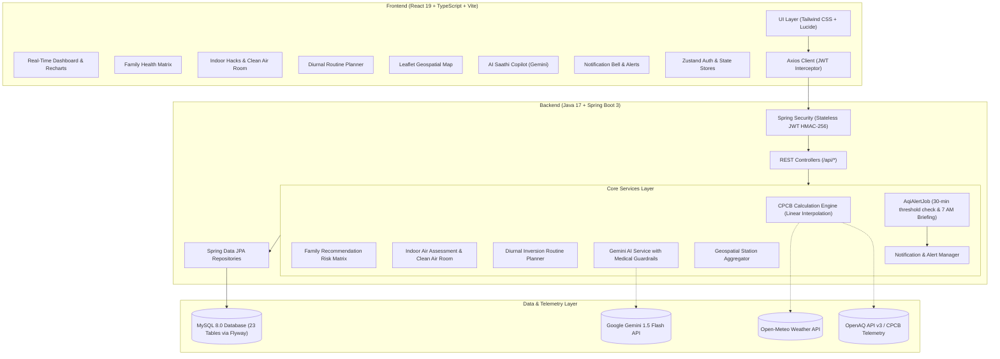

# SaansSaathi 🌿
### *Breathe Better. Live Smarter.*

**AI-Powered Urban Air Quality & Family Health Protection Platform for Winter Smog Mitigation**

[](https://github.com/gondchawarswaraj45/SaansSaathi.git)
[](https://github.com/gondchawarswaraj45/SaansSaathi/actions/workflows/backend-ci.yml)
[](https://github.com/gondchawarswaraj45/SaansSaathi/actions/workflows/frontend-ci.yml)
[](https://spring.io/projects/spring-boot)
[](https://react.dev)
[](https://ai.google.dev/)
[](https://www.sqlite.org/)
[](https://tailwindcss.com)

---

## 📌 Executive Summary & Problem Context

In Indian urban centers (e.g., Delhi NCR, Pune, Mumbai, Jaipur, Lucknow, Kolkata), winter brings severe **atmospheric temperature inversion**. Cold air near the surface becomes trapped beneath a blanket of warm air, arresting vertical convection and preventing pollutant dispersion. Consequently, vehicular emissions, construction dust, industrial effluents, and biomass burning accumulate at ground level, driving AQI values to hazardous (300 to 500+) levels.

Most existing air quality applications simply display a single city-wide number without actionable context. Families face five distinct bottlenecks:
1. **Ambiguity of Danger**: Raw PM2.5 numbers lack actionable medical and lifestyle meaning for different age groups.
2. **Timing of Exposure**: Inversion smog peaks between 6:00 AM and 10:00 AM, precisely when people exercise or commute.
3. **Family Vulnerability Differences**: A healthy adult, a 6-year-old child, an 80-year-old senior, and an asthma patient require radically different precautions.
4. **Indoor Smog Misconceptions**: Indoor air during unventilated cooking or coil burning can be 3x more toxic than outdoor air.
5. **Passive Helplessness**: Lack of structured habits or affordable DIY interventions (such as low-cost HEPA purifiers).

**SaansSaathi** (*सांस साथी — "Your Breath Companion"*) solves these challenges through an end-to-end full-stack web application designed for Indian urban families. It bridges real-time sensor telemetry, algorithmic CPCB calculations, family vulnerability profiling, home air assessment, and Google Gemini AI into an integrated daily protection companion.

---

## 🏛️ System Architecture



---

## 🌟 Core Modules & Capabilities

### 1. 📊 Real-Time CPCB Air Quality Engine
- **Accurate Linear Interpolation**: Implements the official Central Pollution Control Board (CPCB) formula:
  $$\text{AQI} = \frac{I_{\text{high}} - I_{\text{low}}}{B_{\text{high}} - B_{\text{low}}} \times (C - B_{\text{low}}) + I_{\text{low}}$$
- **Multi-Pollutant Tracking**: Evaluates $PM_{2.5}$, $PM_{10}$, $NO_2$, $SO_2$, $CO$, $O_3$, and selects the dominant sub-index.
- **Diurnal Weather Correlation**: Integrates temperature, humidity, wind velocity, and inversion layer indicators via Open-Meteo.
- **24-Hour Recharts Timeline**: Visualizes diurnal curves, showing daytime smog peaks and dispersion periods.

### 2. 👨‍👩‍👧‍👦 Personalized Family Protection Matrix
- **Demographic Vulnerability Profiling**: Profiles family members by life stage (Infant, Child, Adult, Senior) and health condition (Asthma, COPD, Cardiac, Pregnancy).
- **Rule-Based Risk Calculation**: Automatically evaluates individual exposure risks when local AQI transitions across CPCB bands (Good, Satisfactory, Moderate, Poor, Very Poor, Severe).
- **Actionable Safety Protocols**: Prescribes specific interventions: N95/FFP2 respirator advisories, school recess shifts, bronchodilator accessibility notices, and outdoor cardiovascular caps.

### 3. 🏠 Indoor Air Quality Assistant & Clean Air Room
- **3-Step Residential Assessment**: Evaluates kitchen fuel type (LPG vs. Biomass), exhaust capacity, floor elevation, window seals, incense/dhoop burning, and mosquito coil usage.
- **EPA Clean Air Room Blueprint**: Step-by-step guidance to convert an interior room into an ultra-clean refuge during winter smog peaks.
- **Low-Cost DIY Air Purifier Guide**: Complete schematic to construct a high-efficiency particulate filter using an Indian 230V box-fan/exhaust paired with a MERV-13 / HEPA filter for under ₹1,500.
- **Outdoor vs. Indoor Differential**: Real-time comparison estimating indoor PM2.5 levels based on household characteristics.

### 4. 📅 Smart Daily Routine Planner (Diurnal Inversion Sync)
- **Inversion-Aware Scheduling**: Winter smog concentrates between 6:00 AM and 10:00 AM due to radiational cooling. SaansSaathi shifts morning jogging, dog walking, and school transit to protected indoor alternatives.
- **Golden Ventilation Window**: Pinpoints the 1:00 PM – 3:30 PM window when solar heating breaks the inversion layer, allowing fresh air exchange without soot intrusion.
- **Activity Tracker**: Family members can check off completed tasks and log compliance.

### 5. 🤖 AI Saathi (Google Gemini 1.5 Flash Copilot)
- **Multi-Context Enrichment**: Every prompt is enriched with the family's profile, latest home assessment score, and localized station AQI.
- **Medical Safety Guardrails**: Incorporates strict safety boundaries. Never prescribes medicines or diagnoses illnesses; directs users with severe dyspnea, chest tightness, or cyanosis to emergency healthcare providers.
- **Resilient NLP Fallback**: Offline rule-based response engine guarantees assistance even if external LLM quotas or network constraints occur.

### 6. 🗺️ Interactive Geospatial Map (Leaflet + OpenStreetMap)
- **Official CPCB Color Scale**: Map markers are rendered as circular badges with exact numeric AQI values, colored according to CPCB thresholds (#55A630 to #6B0504).
- **Live Station Popups**: Station name, dominant pollutant, last reading timestamp, and a single-click "Set as my location" button.
- **GPS Locate Me**: High-accuracy browser geolocation flies the camera to the user's immediate coordinates and highlights the nearest sensor.

### 7. 🔔 Notifications & Automated Smog Alerts
- **Background Scheduler**: 30-minute background job (`AqiAlertJob`) monitors sensor thresholds against user preferences.
- **Anti-Spam Throttling**: Limits duplicate alerts to once every 2 hours per category.
- **7:00 AM Morning Briefing**: Daily forecast push notification advising families on safe daily schedules before they step out.
- **Interactive Notification Bell**: Real-time unread badge counter, quick preview dropdown, and full preferences dashboard.

### 8. 🏆 Clean Air Challenges & Gamification
- 10 structured community challenges designed to lower emissions (e.g., No-Idle Commutes, Smoke-Free Living, Metro Week).
- Point progression and badges to foster sustainable family habits.

---

## 🎨 CPCB Air Quality Index Standard

SaansSaathi strictly implements India's **Central Pollution Control Board (CPCB)** 6-tier classification:

| AQI Band | Category | Color Code | Health Impact & Primary Recommendation |
|:---:|:---:|:---:|:---|
| **0 – 50** | **Good** | `#55A630` | Minimal impact. Safe for all outdoor activities and natural ventilation. |
| **51 – 100** | **Satisfactory** | `#80B918` | Minor breathing discomfort to sensitive individuals. Normal outdoor routines. |
| **101 – 200** | **Moderate** | `#FFB703` | Breathing discomfort to people with lungs, asthma, and heart diseases. |
| **201 – 300** | **Poor** | `#FB8500` | Breathing discomfort on prolonged exposure. Avoid morning outdoor workouts. |
| **301 – 400** | **Very Poor** | `#D90429` | Respiratory illness on prolonged exposure. Keep windows closed; run HEPA purifiers. |
| **401 – 500** | **Severe** | `#6B0504` | Affects healthy people and seriously impacts those with existing diseases. Stay indoors. |

---

## 📂 Codebase Directory Structure

```
saansSaathi/
├── .github/                        # GitHub Actions CI/CD workflows
│   └── workflows/
│       ├── backend-ci.yml          # Maven test & verification
│       └── frontend-ci.yml         # TypeScript & Vite build checks
│
├── frontend/                       # React 19 + TypeScript + Vite Single-Page Application
│   ├── public/                     # Favicons, web manifest, static assets
│   ├── src/
│   │   ├── api/                    # Axios REST clients
│   │   │   ├── authApi.ts          # Authentication & token refresh
│   │   │   ├── axiosClient.ts      # HTTP interceptor with bearer token injection
│   │   │   ├── chatApi.ts          # Gemini AI conversation endpoints
│   │   │   ├── familyApi.ts        # Family groups & members management
│   │   │   ├── indoorApi.ts        # Home assessment & DIY purifier guides
│   │   │   ├── mapApi.ts           # Geospatial station clusters & popup data
│   │   │   ├── notificationApi.ts  # Notifications, preferences & alerts
│   │   │   └── plannerApi.ts       # Diurnal routine schedule generator
│   │   ├── components/             # Reusable UI components
│   │   │   ├── chatbot/            # AI chat bubble, suggested prompts, sidebar
│   │   │   ├── common/             # NotificationBell, Modal, Card, Button
│   │   │   ├── dashboard/          # AqiBadge, PollutantCard, TrendChart, WeatherCard
│   │   │   ├── family/             # FamilyMemberCard, AddMemberModal, RiskBadge
│   │   │   ├── indoor/             # HomeAssessmentForm, DIYAirPurifierGuide, CleanAirRoom
│   │   │   ├── map/                # MapLegend, StationPopup, LayerControl
│   │   │   └── planner/            # DailyScheduleTimeline, ActivityCard, CustomActivityModal
│   │   ├── layout/                 # Layout wrappers & responsive navigation
│   │   │   ├── AppLayout.tsx       # Main authenticated container
│   │   │   └── Navbar.tsx          # Top navigation with live notification bell
│   │   ├── pages/                  # Route views
│   │   │   ├── AdminPage.tsx       # System telemetry & station health
│   │   │   ├── ChallengesPage.tsx  # Gamified smog reduction challenges
│   │   │   ├── ChatPage.tsx        # Full-page AI Saathi consultation
│   │   │   ├── DashboardPage.tsx   # Live AQI telemetry, 24-hr chart, weather
│   │   │   ├── FamilyPage.tsx      # Family risk matrix & customized advice
│   │   │   ├── IndoorPage.tsx      # Indoor assessment wizard & clean air room guide
│   │   │   ├── LandingPage.tsx     # Public landing page with live smog ticker
│   │   │   ├── LoginPage.tsx       # User login & session initiation
│   │   │   ├── MapPage.tsx         # Leaflet OpenStreetMap live air quality map
│   │   │   ├── NotificationsPage.tsx # Notification center & preference controls
│   │   │   ├── OnboardingPage.tsx  # Initial setup wizard
│   │   │   ├── PlannerPage.tsx     # Diurnal routine generator & timeline
│   │   │   ├── RegisterPage.tsx    # New user onboarding & registration
│   │   │   └── SettingsPage.tsx    # Account preferences & alert thresholds
│   │   ├── store/                  # Zustand persistent stores
│   │   │   └── authStore.ts        # User credentials, JWT tokens & logout handling
│   │   └── assets/                 # Tailwind CSS styles & Leaflet stylesheets
│   ├── package.json
│   ├── tailwind.config.ts
│   └── vite.config.ts
│
├── backend/                        # Java 17 + Spring Boot 3 REST Backend
│   ├── src/main/java/com/saanssaathi/app/
│   │   ├── SaansSaathiApplication.java # Spring Boot entry point (@EnableScheduling)
│   │   ├── common/                 # ApiResponse<T> wrapper & common constants
│   │   ├── config/                 # SecurityConfig, WebConfig (CORS), OpenApiConfig
│   │   ├── controller/             # REST Endpoints
│   │   │   ├── AIController.java           # /api/ai/* (Gemini chat & recommendations)
│   │   │   ├── AirQualityController.java   # /api/airquality/* (Real-time AQI)
│   │   │   ├── AuthController.java         # /api/auth/* (Login, register, refresh)
│   │   │   ├── FamilyController.java       # /api/family/* (Family profiles)
│   │   │   ├── HealthController.java       # /api/health (Readiness & liveness probes)
│   │   │   ├── IndoorController.java       # /api/indoor/* (Home assessments)
│   │   │   ├── MapDataController.java      # /api/map/* (Geospatial station data)
│   │   │   ├── NotificationController.java # /api/notifications/* (Alerts & preferences)
│   │   │   ├── PlannerController.java      # /api/routines/* (Daily schedule generation)
│   │   │   └── UserLocationController.java # /api/locations/* (User saved coordinates)
│   │   ├── exception/              # GlobalExceptionHandler & custom exceptions
│   │   ├── integration/            # External telemetry clients (Open-Meteo, OpenAQ)
│   │   ├── model/
│   │   │   ├── entity/             # JPA Entities (User, Notification, Routine, etc.)
│   │   │   └── dto/                # Request & response data transfer objects
│   │   ├── recommendation/         # Rule-based vulnerability risk engines
│   │   ├── repository/             # Spring Data JPA Repositories
│   │   ├── scheduler/              # AqiAlertJob (Scheduled background evaluations)
│   │   ├── security/               # JwtService, JwtFilter, CustomUserDetailsService
│   │   └── service/                # Business logic interfaces & implementations
│   ├── src/main/resources/
│   │   ├── application.yml         # Spring configuration profiles (dev, prod)
│   │   └── db/migration/           # Flyway Database Migrations
│   │       ├── V1__create_initial_schema.sql # 23 Relational Tables
│   │       └── V2__seed_initial_data.sql     # 30 Indian Cities, Pollutants, Challenges
│   └── pom.xml
│
├── sample images/                  # 9 UI reference benchmarks (Delhi CPCB, IQAir, etc.)
├── suggestions/                    # Architectural suggestion blueprints (6 files)
├── task.txt                        # Master 15-step development roadmap & progress
├── docker-compose.yml              # Local container orchestration (MySQL + Apps)
└── README.md                       # Comprehensive documentation
```

---

## 🚀 Quick Start & Local Setup

### System Prerequisites
- **Java**: OpenJDK 17 or higher
- **Node.js**: v18.0.0 or higher (v20+ recommended)
- **Maven**: 3.8+ (or included wrapper)
- **Database**: MySQL 8.0+ (or via Docker)

### 1. Clone Repository
```bash
git clone https://github.com/gondchawarswaraj45/SaansSaathi.git
cd saansSaathi
```

### 2. Start MySQL via Docker
```bash
docker compose up -d mysql
```
*Flyway will automatically execute migrations `V1` and `V2` upon Spring Boot startup, creating 23 tables and seeding initial Indian urban data.*

### 3. Run Backend (Spring Boot)
```bash
cd backend
mvn clean spring-boot:run -Dspring-boot.run.profiles=dev
```
- Server starts at: `http://localhost:8080`
- Interactive Swagger OpenAPI UI: `http://localhost:8080/swagger-ui.html`

### 4. Run Frontend (React + Vite)
```bash
cd ../frontend
npm install
npm run dev
```
- Single-page application renders at: `http://localhost:5173`

---

## 🌐 Production Deployment Architecture

SaansSaathi is built for cloud deployment across decoupled platforms:

| Component | Platform | Configuration |
|:---|:---|:---|
| **Frontend** | **Vercel / Netlify** | Vite static build (`npm run build`), automatic client-side routing rewrites (`vercel.json` & `_redirects`), HTTP proxy to backend. |
| **Backend** | **Render / Railway** | Containerized Spring Boot 17 (`Dockerfile` multi-stage build or `render.yaml` 1-click blueprint), zero-downtime health probes at `/api/health`. |
| **Database** | **SQLite (Embedded) / Railway MySQL** | Portable SQLite database with auto-seeding via `DataInitializer` or remote MySQL with connection pooling (`HikariCP`). |
| **AI Copilot** | **Google Cloud Vertex AI / Gemini API** | Secured backend-to-backend API key authentication with strict rate limits and medical triage guardrails. |
| **CI/CD** | **GitHub Actions** | Automated multi-stage testing on every push and PR (`backend-ci.yml` & `frontend-ci.yml`). |

---

## 🔒 Security & Privacy Guarantees

1. **Stateless JWT Authentication**: Passwords hashed using bcrypt (strength 12); access tokens signed with HMAC-SHA256 with 15-minute expiration; refresh tokens stored securely.
2. **Medical Guardrails**: Medical disclaimers accompany all AI-generated advice. The system never provides pharmaceutical dosages or diagnostic claims.
3. **Zero PII Exposure**: Telemetry lookups are bound to station coordinates; exact home addresses are never exposed or transmitted unencrypted.
4. **Environment Isolation**: API secrets and Gemini API keys reside exclusively in backend environment variables and are never surfaced in client bundles.

---

## 🤝 Contributing & License

Contributions, feedback, and pull requests are warmly welcome!
- **License**: MIT License
- **Author & Maintainer**: Swaraj Gondchawar ([@gondchawarswaraj45](https://github.com/gondchawarswaraj45))
- **Repository**: [https://github.com/gondchawarswaraj45/SaansSaathi.git](https://github.com/gondchawarswaraj45/SaansSaathi.git)
