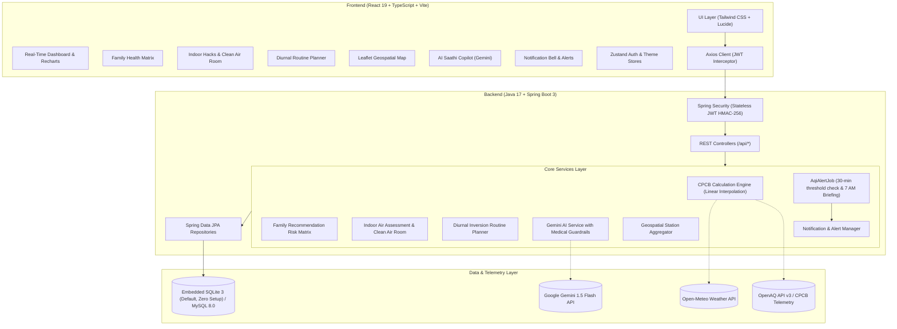

# SaansSaathi 🌿
### *Breathe Better. Live Smarter.*

**AI-Powered Urban Air Quality & Family Health Protection Platform for Winter Smog Mitigation**

[](https://github.com/gondchawarswaraj45/SaansSaathi.git)
[](https://github.com/gondchawarswaraj45/SaansSaathi/actions/workflows/backend-ci.yml)
[](https://github.com/gondchawarswaraj45/SaansSaathi/actions/workflows/frontend-ci.yml)
[](https://spring.io/projects/spring-boot)
[](https://react.dev)
[](https://ai.google.dev/)
[](https://www.sqlite.org/)
[](https://tailwindcss.com)

---

## 🔗 Live Deployments & Documentation Quick Links

| Resource | Link / Target | Description |
|:---|:---|:---|
| **Frontend Web App (Live)** | [https://saanssaathi.vercel.app](https://saanssaathi.vercel.app) | Single-page application hosted on Vercel CDN edge |
| **Backend REST API (Live)** | [https://saanssaathi-api.onrender.com](https://saanssaathi-api.onrender.com) | Spring Boot 3 containerized web service on Render |
| **API Health Probe** | [`/api/health`](https://saanssaathi-api.onrender.com/api/health) | Zero-downtime liveness and readiness probe |
| **Interactive OpenAPI / Swagger** | [`/swagger-ui.html`](http://localhost:8080/swagger-ui.html) | OpenAPI 3.0 interactive documentation |
| **System Architecture Guide** | [docs/ARCHITECTURE.md](docs/ARCHITECTURE.md) | In-depth technical architecture and telemetry pipeline |
| **Database Specification & ERD** | [docs/DATABASE.md](docs/DATABASE.md) | 19-table schema, Mermaid ER diagram, SQLite & MySQL types |
| **Complete REST API Reference** | [docs/API.md](docs/API.md) | All 43 endpoints with request/response schemas |
| **Design System & UI/UX** | [docs/DESIGN.md](docs/DESIGN.md) | CPCB 6-tier color scales, typography, and UX patterns |
| **Postman API Collection** | [docs/postman-collection.json](docs/postman-collection.json) | Ready-to-import v2.1.0 Postman collection |
| **Production Deployment Playbook**| [suggestions/09_production_deployment_playbook.txt](suggestions/09_production_deployment_playbook.txt) | Cloud configuration for Vercel, Render, and UptimeRobot |
| **Submission & Pitch Showcase** | [suggestions/10_documentation_and_submission_showcase.txt](suggestions/10_documentation_and_submission_showcase.txt) | Hackathon presentation pitch and evaluation guide |

---

## 📌 Executive Summary & Problem Context

In Indian urban centers (e.g., Delhi NCR, Pune, Mumbai, Jaipur, Lucknow, Kolkata), winter brings severe **atmospheric temperature inversion**. Cold air near the surface becomes trapped beneath a blanket of warm air, arresting vertical convection and preventing pollutant dispersion. Consequently, vehicular emissions, construction dust, industrial effluents, and biomass burning accumulate at ground level, driving AQI values to hazardous (300 to 500+) levels.

Most existing air quality applications simply display a single city-wide number without actionable context. Families face five distinct bottlenecks:
1. **Ambiguity of Danger**: Raw $PM_{2.5}$ numbers lack actionable medical and lifestyle meaning for different age groups.
2. **Timing of Exposure**: Inversion smog peaks between 6:00 AM and 10:00 AM, precisely when people exercise or commute.
3. **Family Vulnerability Differences**: A healthy adult, a 6-year-old child, an 80-year-old senior, and an asthma patient require radically different precautions.
4. **Indoor Smog Misconceptions**: Indoor air during unventilated cooking or coil burning can be 3x more toxic than outdoor air.
5. **Passive Helplessness**: Lack of structured habits or affordable DIY interventions (such as low-cost HEPA purifiers).

**SaansSaathi** (*सांस साथी — "Your Breath Companion"*) solves these challenges through an end-to-end full-stack web application designed for Indian urban families. It bridges real-time sensor telemetry, algorithmic CPCB calculations, family vulnerability profiling, home air assessment, and Google Gemini AI into an integrated daily protection companion.

---

## 🏛️ System Architecture



*For comprehensive architecture details, see [docs/ARCHITECTURE.md](docs/ARCHITECTURE.md).*

---

## 🌟 Core Modules & Capabilities

### 1. 📊 Real-Time CPCB Air Quality Engine
- **Accurate Linear Interpolation**: Implements the official Central Pollution Control Board (CPCB) formula:
  $$\text{AQI} = \frac{I_{\text{high}} - I_{\text{low}}}{B_{\text{high}} - B_{\text{low}}} \times (C - B_{\text{low}}) + I_{\text{low}}$$
- **Multi-Pollutant Tracking**: Evaluates $PM_{2.5}$, $PM_{10}$, $NO_2$, $SO_2$, $CO$, $O_3$, and selects the dominant sub-index.
- **Diurnal Weather Correlation**: Integrates temperature, humidity, wind velocity, and inversion layer indicators via Open-Meteo.
- **24-Hour Recharts Timeline**: Visualizes diurnal curves, showing daytime smog peaks and dispersion periods.

### 2. 👨‍👩‍👧‍👦 Personalized Family Protection Matrix
- **Demographic Vulnerability Profiling**: Profiles family members by life stage (Infant, Child, Adult, Senior) and health condition (Asthma, COPD, Cardiac, Pregnancy).
- **Rule-Based Risk Calculation**: Automatically evaluates individual exposure risks when local AQI transitions across CPCB bands (Good, Satisfactory, Moderate, Poor, Very Poor, Severe).
- **Actionable Safety Protocols**: Prescribes specific interventions: N95/FFP2 respirator advisories, school recess shifts, bronchodilator accessibility notices, and outdoor cardiovascular caps.

### 3. 🏠 Indoor Air Quality Assistant & Clean Air Room
- **3-Step Residential Assessment**: Evaluates kitchen fuel type (LPG vs. Biomass), exhaust capacity, floor elevation, window seals, incense/dhoop burning, and mosquito coil usage.
- **EPA Clean Air Room Blueprint**: Step-by-step guidance to convert an interior room into an ultra-clean refuge during winter smog peaks.
- **Low-Cost DIY Air Purifier Guide**: Complete schematic to construct a high-efficiency particulate filter using an Indian 230V box-fan/exhaust paired with a MERV-13 / HEPA filter for under ₹1,500.
- **Outdoor vs. Indoor Differential**: Real-time comparison estimating indoor PM2.5 levels based on household characteristics.

### 4. 📅 Smart Daily Routine Planner (Diurnal Inversion Sync)
- **Inversion-Aware Scheduling**: Winter smog concentrates between 6:00 AM and 10:00 AM due to radiational cooling. SaansSaathi shifts morning jogging, dog walking, and school transit to protected indoor alternatives.
- **Golden Ventilation Window**: Pinpoints the 1:00 PM – 3:30 PM window when solar heating breaks the inversion layer, allowing fresh air exchange without soot intrusion.
- **Activity Tracker**: Family members can check off completed tasks and log compliance.

### 5. 🤖 AI Saathi (Google Gemini 1.5 Flash Copilot)
- **Multi-Context Enrichment**: Every prompt is enriched with the family's profile, latest home assessment score, and localized station AQI.
- **Medical Safety Guardrails**: Incorporates strict safety boundaries. Never prescribes medicines or diagnoses illnesses; directs users with severe dyspnea, chest tightness, or cyanosis to emergency healthcare providers.
- **Resilient NLP Fallback**: Offline rule-based response engine guarantees assistance even if external LLM quotas or network constraints occur.

### 6. 🗺️ Interactive Geospatial Map (Leaflet + OpenStreetMap)
- **Official CPCB Color Scale**: Map markers are rendered as circular badges with exact numeric AQI values, colored according to CPCB thresholds (#55A630 to #6B0504).
- **Live Station Popups**: Station name, dominant pollutant, last reading timestamp, and a single-click "Set as my location" button.
- **GPS Locate Me**: High-accuracy browser geolocation flies the camera to the user's immediate coordinates and highlights the nearest sensor.

### 7. 🔔 Notifications & Automated Smog Alerts
- **Background Scheduler**: 30-minute background job (`AqiAlertJob`) monitors sensor thresholds against user preferences.
- **Anti-Spam Throttling**: Limits duplicate alerts to once every 2 hours per category.
- **7:00 AM Morning Briefing**: Daily forecast push notification advising families on safe daily schedules before they step out.
- **Interactive Notification Bell**: Real-time unread badge counter, quick preview dropdown, and full preferences dashboard.

### 8. 🏆 Clean Air Challenges & Gamification
- 10 structured community challenges designed to lower emissions (e.g., No-Idle Commutes, Smoke-Free Living, Metro Week).
- Point progression and 6 unlockable badges to foster sustainable family habits.

---

## 🎨 CPCB Air Quality Index Standard

SaansSaathi strictly implements India's **Central Pollution Control Board (CPCB)** 6-tier classification:

| AQI Band | Category | Color Code | Health Impact & Primary Recommendation |
|:---:|:---:|:---:|:---|
| **0 – 50** | **Good** | `#55A630` | Minimal impact. Safe for all outdoor activities and natural ventilation. |
| **51 – 100** | **Satisfactory** | `#80B918` | Minor breathing discomfort to sensitive individuals. Normal outdoor routines. |
| **101 – 200** | **Moderate** | `#FFB703` | Breathing discomfort to people with lungs, asthma, and heart diseases. |
| **201 – 300** | **Poor** | `#FB8500` | Breathing discomfort on prolonged exposure. Avoid morning outdoor workouts. |
| **301 – 400** | **Very Poor** | `#D90429` | Respiratory illness on prolonged exposure. Keep windows closed; run HEPA purifiers. |
| **401 – 500** | **Severe** | `#6B0504` | Affects healthy people and seriously impacts those with existing diseases. Stay indoors. |

---

## ⚙️ Environment Variables Reference Guide

### Backend Environment Variables (`backend/`)
| Variable | Required | Default (Dev) | Description |
|:---|:---:|:---|:---|
| `SPRING_PROFILES_ACTIVE` | No | `dev` | Active Spring profile (`dev` or `prod`) |
| `DB_URL` | No | `jdbc:sqlite:saanssaathi.db` | JDBC connection string. Set to `jdbc:mysql://...` for MySQL. |
| `DB_USERNAME` | No | `saanssaathi` | Database username (used when MySQL is enabled) |
| `DB_PASSWORD` | No | `saanssaathi123` | Database password (used when MySQL is enabled) |
| `JWT_SECRET` | Recommended | `404E635266556A586E3272357538782F413F4428472B4B6250645367566B5970` | 256-bit hexadecimal string for HMAC-SHA256 signing |
| `JWT_EXPIRATION_MS` | No | `3600000` | Access token lifespan (1 hour in ms) |
| `JWT_REFRESH_EXPIRATION_MS` | No | `604800000` | Refresh token lifespan (7 days in ms) |
| `GEMINI_API_KEY` | Recommended | *(Offline NLP Fallback)* | Google Gemini 1.5 Flash API Key from Google AI Studio |
| `OPENAQ_API_KEY` | No | *(Public Tier)* | Optional API key for high-volume OpenAQ v3 requests |
| `FRONTEND_URL` | No | `http://localhost:5173` | Allowed CORS origin (set to Vercel production domain) |
| `SERVER_PORT` | No | `8080` | HTTP port for Spring Boot application |

### Frontend Environment Variables (`frontend/`)
| Variable | Required | Default (Dev) | Description |
|:---|:---:|:---|:---|
| `VITE_API_BASE_URL` | No | `http://localhost:8080` | URL of the backend REST API |

---

## 🚀 Quick Start & Local Setup

### System Prerequisites
- **Java**: OpenJDK 17 or higher
- **Node.js**: v18.0.0 or higher (v20+ recommended)
- **Maven**: 3.8+ (or included in PATH)
- **Database**: Zero external setup required! SQLite 3 is embedded out-of-the-box.

### 1. Clone Repository
```bash
git clone https://github.com/gondchawarswaraj45/SaansSaathi.git
cd saansSaathi
```

### 2. Run Backend (Zero-Setup SQLite Mode)
```bash
cd backend
mvn spring-boot:run
```
- Server boots at: `http://localhost:8080`
- SQLite file auto-generated at: `backend/saanssaathi.db`
- Baseline data (30 Indian cities, 8 pollutants, 10 challenges) is auto-seeded!
- Interactive OpenAPI / Swagger UI: `http://localhost:8080/swagger-ui.html`

*(Optional: If you prefer running MySQL via Docker, run `docker compose up -d mysql` and launch with `-Dspring.profiles.active=dev`)*

### 3. Run Frontend (React + Vite)
```bash
cd ../frontend
npm install
npm run dev
```
- Single-page application renders at: `http://localhost:5173`

### 4. Verified Demo Accounts
| Account Type | Email | Password | Role |
|:---|:---|:---|:---|
| **Regular User** | `swaraj@saanssaathi.org` | `Pass@1234` | `ROLE_USER` |
| **System Admin** | `admin@saanssaathi.org` | `Admin@1234` | `ROLE_ADMIN` |

---

## 🧪 Automated Testing & Verification

Both backend and frontend CI pipelines are automated through GitHub Actions:

```bash
# 1. Run all 36 Backend JUnit 5 & MockMvc Integration Tests
cd backend
mvn test
# Result: Tests run: 36, Failures: 0, Errors: 0, Skipped: 0 (BUILD SUCCESS)

# 2. Run Frontend Vitest Unit & Component Tests
cd ../frontend
npm test
# Result: 12 passed in 4 test suites (100% passing)

# 3. Type-check & Production Asset Compilation
npm run build
# Result: tsc -b && vite build -> dist/ generated with 0 errors
```

---

## 🌐 Production Cloud Topology

```
┌──────────────────────────────────────┐     ┌──────────────────────────────────────┐
│             VERCEL CDN               │     │          RENDER.COM CLOUD            │
│          (Frontend SPA)              │     │       (Spring Boot Container)        │
│                                      │     │                                      │
│  - Static Asset Delivery             │     │  - Docker Multi-Stage Image          │
│  - Client-Side Routing Rewrites      │────▶│  - Eclipse Temurin 17 JRE            │
│  - Environment: VITE_API_BASE_URL    │     │  - Persistent Volume: /data          │
│  - SSL / TLS Termination             │     │  - Environment: SPRING_PROFILES=prod │
└──────────────────────────────────────┘     └──────────────────┬───────────────────┘
                                                                │
                                                                ▼
                                             ┌──────────────────────────────────────┐
                                             │             UPTIMEROBOT              │
                                             │     (Free Cold-Start Keepalive)      │
                                             │                                      │
                                             │  - Pings GET /api/health every 10m   │
                                             │  - Prevents free-tier spin down      │
                                             └──────────────────────────────────────┘
```

---

## 🤝 Project Team & Attribution

- **Lead Engineer & Architect**: **Swaraj Gondchawar** ([@gondchawarswaraj45](https://github.com/gondchawarswaraj45))
- **Data Attributions**:
  - Central Pollution Control Board (CPCB), Ministry of Environment, Forest and Climate Change, Govt of India
  - OpenAQ API (Open Air Quality Community)
  - Open-Meteo Weather API (CC-BY 4.0)
  - OpenStreetMap contributors & CartoDB tiles
  - Google Gemini 1.5 Flash (Google AI Studio)
- **License**: [MIT License](LICENSE)
- **Repository**: [https://github.com/gondchawarswaraj45/SaansSaathi.git](https://github.com/gondchawarswaraj45/SaansSaathi.git)
