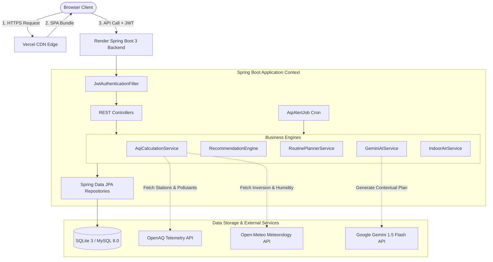

# SaansSaathi - Complete System Architecture Documentation

## 1. Executive Architecture Overview

**SaansSaathi** (*सांस साथी — "Breathe Better. Live Smarter."*) is a resilient, full-stack, cloud-native urban air quality telemetry and personalized family protection platform engineered specifically for Indian metropolitan centers facing severe winter smog and atmospheric temperature inversion.

```
┌────────────────────────────────────────────────────────────────────────────────────────┐
│                                   CLIENT LAYER (Browser)                                │
│                     React 19 SPA + TypeScript + Vite + Tailwind CSS v3                  │
│                     Global Dark/Light Theme + Leaflet Map + Recharts                    │
└───────────────────────────────────────────┬────────────────────────────────────────────┘
                                            │ HTTPS (TLS 1.3) + REST API
                                            │ Authorization: Bearer <JWT>
                                            ▼
┌────────────────────────────────────────────────────────────────────────────────────────┐
│                              SPRING BOOT 3.3 BACKEND (Java 17)                         │
│                                                                                        │
│  ┌───────────────────────┐  ┌───────────────────────────┐  ┌───────────────────────┐  │
│  │   JwtAuthFilter       │  │    REST Controllers       │  │ GlobalExceptionHandler │  │
│  │   (HMAC-256 Stateless)│→ │    (12 Modules, 43 APIs)  │→ │ (Unified ApiResponse) │  │
│  └───────────────────────┘  └─────────────┬─────────────┘  └───────────────────────┘  │
│                                           │                                            │
│  ┌────────────────────────────────────────┴─────────────────────────────────────────┐  │
│  │                                 SERVICE LAYER                                    │  │
│  │  ┌──────────────────────┐  ┌───────────────────────┐  ┌───────────────────────┐  │  │
│  │  │ AqiCalculationService│  │ RecommendationEngine  │  │   IndoorAirService    │  │  │
│  │  │ (CPCB Linear Interp) │  │ (Family Vulnerability)│  │ (Clean Air Room + DIY)│  │  │
│  │  ├──────────────────────┤  ├───────────────────────┤  ├───────────────────────┤  │  │
│  │  │ RoutinePlannerService│  │   GeminiAIService     │  │  NotificationService  │  │  │
│  │  │ (Diurnal Inversion)  │  │ (Safety Guardrails)   │  │ (30-min Anti-Spam Job)│  │  │
│  │  └──────────────────────┘  └───────────────────────┘  └───────────────────────┘  │  │
│  └────────────────────────────────────────┬─────────────────────────────────────────┘  │
│                                           │                                            │
│  ┌────────────────────────────────────────▼─────────────────────────────────────────┐  │
│  │                         PERSISTENCE & DATA LAYER (JPA / Hibernate 6)             │  │
│  │                                                                                  │  │
│  │   Primary: Embedded SQLite 3 (/data/saanssaathi.db) - Zero Setup Required        │  │
│  │   Secondary Fallback: Cloud MySQL 8.0 (Railway / AWS RDS via DB_URL)             │  │
│  │   Auto-Bootstrap: DataInitializer seeds 30 Indian Cities, Pollutants, Challenges │  │
│  └──────────────────────────────────────────────────────────────────────────────────┘  │
└───────────────────────────────────────────┬────────────────────────────────────────────┘
                                            │ Asynchronous Outbound Telemetry
                                            ▼
┌────────────────────────────────────────────────────────────────────────────────────────┐
│                                 EXTERNAL SERVICES & APIS                               │
│  ┌────────────────────────┐  ┌────────────────────────┐  ┌───────────────────────────┐ │
│  │   OpenAQ API v3 / CPCB │  │    Open-Meteo Weather  │  │  Google Gemini 1.5 Flash  │ │
│  │   Real-Time Telemetry  │  │  Inversion & Wind Data │  │  Medical Triage Guardrails│ │
│  └────────────────────────┘  └────────────────────────┘  └───────────────────────────┘ │
└────────────────────────────────────────────────────────────────────────────────────────┘
```

---

## 2. Architectural Principles & Invariants

1. **Safety First (Zero Prescriptive Medicine)**: The platform will never diagnose clinical diseases or alter prescribed pharmaceutical dosages. In severe health scenarios, it automatically generates triage alerts directing the user to the nearest medical emergency facility.
2. **CPCB Mathematical Rigor**: Air Quality Index (AQI) values are strictly calculated using India's official Central Pollution Control Board (CPCB) linear interpolation sub-index standard, rather than US EPA or raw uncalibrated sensor formulas.
3. **Zero-Setup Database Architecture**: The backend ships out-of-the-box with an embedded SQLite 3 engine running on Hibernate 6 Community Dialects. When deployed in production containers, it uses a persistent Docker mount (`/data/saanssaathi.db`). If an enterprise MySQL connection string (`DB_URL`) is supplied, it gracefully switches to MySQL 8.0 with HikariCP connection pooling.
4. **Diurnal Inversion Synchronization**: Recommendations reflect the physics of atmospheric planetary boundary layer collapse during Indian winters (smog peaks 6:00 AM – 10:00 AM; solar ventilation window 1:00 PM – 3:30 PM).
5. **Decoupled Stateless Architecture**: Client state is decoupled from backend server memory. All session authorization is managed via cryptographically signed JWT HMAC-256 tokens with rotating refresh tokens stored in the database.

---

## 3. High-Level Component Flow



---

## 4. Frontend Single-Page Application (SPA)

The frontend is constructed using **React 19**, **TypeScript**, and **Vite**, styled with **Tailwind CSS v3**:

### 4.1 Component Hierarchy & Route Structure
- `/` (`LandingPage.tsx`): Public hero section with live unauthenticated smog ticker, 3-pillar protection breakdown, interactive AQI scale, and 8-item FAQ accordion.
- `/login` & `/register` (`LoginPage.tsx`, `RegisterPage.tsx`): Stateless JWT authentication with email validation and error toasts.
- `/onboarding` (`OnboardingPage.tsx`): 3-step wizard collecting city location, primary household vulnerabilities, and initial clean air settings.
- `/dashboard` (`DashboardPage.tsx`): Mission-control view featuring live station AQI badge, CPCB color pulse, dominant pollutant indicator, 24-hour diurnal Recharts curve, weather metrics, and daily AI tip.
- `/family` (`FamilyPage.tsx`): Multi-member household registry with age-group classification (Infant, Child, Adult, Senior) and health vulnerability tagging (Asthma, COPD, Cardiovascular).
- `/indoor` (`IndoorPage.tsx`): 3-step home assessment wizard, outdoor-to-indoor PM2.5 attenuation estimator, EPA Clean Air Room blueprint, and DIY ₹1,500 Box-Fan HEPA purifier step-by-step schematics.
- `/planner` (`PlannerPage.tsx`): Diurnal schedule timeline showing hour-by-hour outdoor/indoor risk ratings, automatic inversion shifts, and golden ventilation windows.
- `/map` (`MapPage.tsx`): Fullscreen interactive Leaflet map featuring OpenStreetMap tiles, CPCB color-coded station pins with radial pulse animations, popup metrics, and GPS locate-me.
- `/chat` (`ChatPage.tsx`): Full-page AI consultation window with streaming bubble animations, multi-session sidebar, and quick-prompt suggestion chips.
- `/notifications` (`NotificationsPage.tsx`): Complete alerts feed with unread filters, category icons, and customizable threshold settings.
- `/challenges` (`ChallengesPage.tsx`): Community behavioral gamification with 10 structured challenges, 6 unlockable badges, and 7-day progress logging.
- `/admin` (`AdminPage.tsx`): System telemetry dashboard monitoring database health, upstream API latencies, user status toggle, and emergency broadcast modal.
- `/about`, `/privacy`, `/terms`: Legal transparency, privacy compliance, data provenance, and health disclaimers.

### 4.2 State Management
- **`authStore.ts` (Zustand)**: Persists user identity, JWT access token, and refresh token in `localStorage`. Automatically clears credentials and redirects to `/login` upon 401 unauthenticated responses.
- **`themeStore.ts` (Zustand)**: Manages dark/light theme switching, syncing `.dark` class to `document.documentElement` and listening for OS preference changes.
- **Axios HTTP Client**: Configured with automated request interceptors for Bearer token injection and response interceptors for seamless token refresh attempts.

---

## 5. Backend Service Architecture & Core Engines

The backend is built on **Spring Boot 3.3.6** with **Java 17**:

### 5.1 CPCB Linear Interpolation Calculation Engine
India's Central Pollution Control Board defines the National Air Quality Index (NAQI) using a piecewise linear interpolation sub-index formula:

$$I_p = \frac{I_{\text{high}} - I_{\text{low}}}{B_{\text{high}} - B_{\text{low}}} \times (C_p - B_{\text{low}}) + I_{\text{low}}$$

Where:
- $I_p$ is the sub-index for pollutant $p$.
- $C_p$ is the observed 24-hour truncated average concentration.
- $B_{\text{high}}, B_{\text{low}}$ are the breakpoint concentrations encompassing $C_p$.
- $I_{\text{high}}, I_{\text{low}}$ are the AQI scale breakpoints corresponding to $B_{\text{high}}, B_{\text{low}}$.

#### CPCB Breakpoint Table (Concentration in $\mu g/m^3$, CO in $mg/m^3$):
| Category | AQI Range | $PM_{2.5}$ | $PM_{10}$ | $NO_2$ | $SO_2$ | $CO$ | $O_3$ |
|:---|:---:|:---:|:---:|:---:|:---:|:---:|:---:|
| **Good** | 0 – 50 | 0 – 30 | 0 – 50 | 0 – 40 | 0 – 40 | 0 – 1.0 | 0 – 50 |
| **Satisfactory** | 51 – 100 | 31 – 60 | 51 – 100 | 41 – 80 | 41 – 80 | 1.1 – 2.0 | 51 – 100 |
| **Moderate** | 101 – 200 | 61 – 90 | 101 – 250 | 81 – 180 | 81 – 380 | 2.1 – 10.0 | 101 – 168 |
| **Poor** | 201 – 300 | 91 – 120 | 251 – 350 | 181 – 280 | 381 – 800 | 10.1 – 17.0 | 169 – 208 |
| **Very Poor** | 301 – 400 | 121 – 250 | 351 – 430 | 281 – 400 | 801 – 1600 | 17.1 – 34.0 | 209 – 748 |
| **Severe** | 401 – 500 | 250+ | 430+ | 400+ | 1600+ | 34.0+ | 748+ |

**Dominant Pollutant Selection**: The overall AQI is taken as the maximum sub-index across all monitored pollutants:
$$\text{AQI}_{\text{overall}} = \max(I_{\text{PM2.5}}, I_{\text{PM10}}, I_{\text{NO2}}, I_{\text{SO2}}, I_{\text{CO}}, I_{\text{O3}})$$
If both $PM_{2.5}$ and $PM_{10}$ are missing, the overall index is flagged as uncalculated according to CPCB monitoring guidelines.

---

### 5.2 Diurnal Atmospheric Inversion Engine
During Northern Indian winters (November to February), ground-level radiational cooling causes a sharp temperature inversion. Cooler, denser air containing particulate matter is trapped below warmer air aloft:
- **Morning Peak Hazard (06:00 – 10:00)**: Surface inversion reaches maximum stability. Planetary boundary layer height drops to 100–200 meters. PM2.5 concentrations peak at 300–600 $\mu g/m^3$.
  - *Engine Directive*: Cancel outdoor runs, prohibit school recess, close all external windows, and activate HEPA purifiers.
- **Golden Ventilation Window (13:00 – 15:30)**: Direct solar irradiance breaks the inversion layer; thermal convection expands boundary layer height to 800–1200 meters, dramatically lowering particulate density.
  - *Engine Directive*: Recommended ventilation window for 30–45 minutes with cross-breeze.
- **Evening Re-Inversion (18:00 – 22:00)**: Rapid ground cooling restores inversion; evening traffic emissions produce a secondary toxic peak.
  - *Engine Directive*: Seal windows, use N95 respirators for commutes, seal door draft gaps.

---

### 5.3 Family Vulnerability Risk Engine
The `RecommendationEngine` evaluates each registered family member against a multi-factor risk matrix:

1. **Age Vulnerability Multiplier**:
   - `CHILD`: Higher respiratory volume relative to body weight; undeveloped lung alveoli.
   - `SENIOR`: Reduced cardiovascular elasticity and impaired cilia clearance.
2. **Clinical Sensitivity**:
   - `RESPIRATORY` (Asthma, COPD): Triggers immediate bronchodilator accessibility alerts when AQI > 150.
   - `CARDIOVASCULAR` (Hypertension, Arrhythmia): Caps outdoor heart rate exertion when AQI > 200.
   - `PREGNANCY`: Requires zero exposure to carbon monoxide and PM2.5 to prevent placental barrier crossing.

---

### 5.4 AI Saathi Copilot with Safety Guardrails
The `GeminiAIService` leverages Google's **Gemini 1.5 Flash** model via a prompt-enrichment pipeline:
1. **Dynamic Context Assembly**: Each user query is prepended with:
   - Current local station AQI, dominant pollutant, and weather conditions.
   - Complete family vulnerability profile (ages, conditions).
   - Household indoor assessment score and purifier status.
2. **Strict System Prompt Guardrails**:
   - Never diagnose diseases or prescribe pharmacological drugs.
   - Flag clinical red flags (cyanosis, severe wheezing, chest pain) with immediate emergency hotline numbers (112 / 102).
   - Only recommend verified particulate mitigation (N95 masks, HEPA filtration, wet mopping, exhaust fans).
3. **Deterministic NLP Fallback**: If external API quota or network failures occur, a rule-based expert system answers common questions seamlessly without dropping the conversation.

---

### 5.5 Scheduled Background Jobs (`AqiAlertJob`)
The `@EnableScheduling` Spring daemon runs two asynchronous tasks:
1. **30-Minute Threshold Monitor (`0 */30 * * * *`)**:
   - Iterates through active user monitoring stations.
   - Detects band transitions (e.g., Moderate -> Poor -> Severe).
   - Generates notifications with anti-spam suppression (maximum 1 alert per category per 2 hours).
2. **07:00 AM Daily Morning Briefing (`0 0 7 * * *`)**:
   - Delivers proactive morning intelligence to every household detailing expected diurnal peaks and safe transit hours.

---

## 6. Database & Storage Architecture

### 6.1 Dual-Engine Design: SQLite 3 + MySQL 8.0 Fallback
- **Development & Single-Node Production**: Uses **SQLite 3** via `sqlite-jdbc` and `org.hibernate.community.dialect.SQLiteDialect`. Requires zero external daemon processes or cloud database provisioning. Database is persisted to a local file or container volume (`/data/saanssaathi.db`).
- **Distributed Enterprise Deployment**: If the `DB_URL` environment variable begins with `jdbc:mysql:`, the system seamlessly switches to **MySQL 8.0** with `com.mysql.cj.jdbc.Driver` and `HikariCP` connection pooling.
- **Automated Seeding (`DataInitializer`)**: Upon boot, `DataInitializer` verifies baseline integrity and automatically seeds:
  - 30 Major Indian Cities with GPS coordinates.
  - 8 Standard Criteria Pollutants with CPCB sub-index breakpoints.
  - 10 Community Clean Air Challenges.
  - Verified default administrative and demonstration accounts.

---

## 7. Security Architecture

1. **Stateless JWT Tokens**:
   - Access tokens generated using HMAC-SHA256 with 1-hour validity.
   - Refresh tokens stored in the `refresh_tokens` table with 7-day expiration and automatic rotation upon use.
2. **Password Security**: Passwords hashed using Spring Security `BCryptPasswordEncoder` with strength factor 12.
3. **CORS Governance**: Configured strictly in `WebConfig.java` to whitelist `FRONTEND_URL` and `http://localhost:5173`.
4. **Secret Isolation**: All credentials (`JWT_SECRET`, `GEMINI_API_KEY`, `OPENAQ_API_KEY`) are managed exclusively through environment variables. No secrets are packaged into the client bundle or source repository.
5. **Role-Based Access Control (RBAC)**: Endpoints under `/api/admin/**` require `ROLE_ADMIN` authorization; user endpoints require `ROLE_USER` or `ROLE_ADMIN`.

---

## 8. Production Cloud Topology & CI/CD

```
┌──────────────────────────────────────┐     ┌──────────────────────────────────────┐
│             VERCEL CDN               │     │          RENDER.COM CLOUD            │
│          (Frontend SPA)              │     │       (Spring Boot Container)        │
│                                      │     │                                      │
│  - Static Asset Delivery             │     │  - Docker Multi-Stage Image          │
│  - Client-Side Routing Rewrites      │────▶│  - Eclipse Temurin 17 JRE            │
│  - Environment: VITE_API_BASE_URL    │     │  - Persistent Volume: /data          │
│  - SSL / TLS Termination             │     │  - Environment: SPRING_PROFILES=prod │
└──────────────────────────────────────┘     └──────────────────┬───────────────────┘
                                                                │
                                                                ▼
                                             ┌──────────────────────────────────────┐
                                             │             UPTIMEROBOT              │
                                             │     (Free Cold-Start Keepalive)      │
                                             │                                      │
                                             │  - Pings GET /api/health every 10m   │
                                             │  - Prevents free-tier spin down      │
                                             └──────────────────────────────────────┘
```

- **GitHub Actions Workflows**:
  - `.github/workflows/backend-ci.yml`: Validates Java 17, executes all 36 JUnit/MockMvc integration tests, and verifies zero compilation warnings.
  - `.github/workflows/frontend-ci.yml`: Validates Node.js 20, runs TypeScript compiler (`tsc --noEmit`), Oxlint linter, all 12 Vitest unit tests, and packages production assets via `npm run build`.
