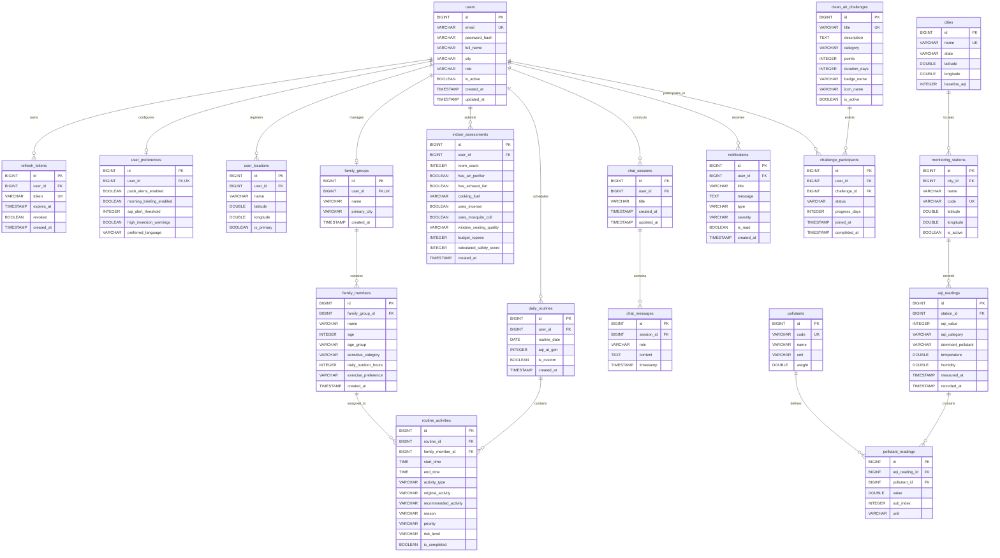

# SaansSaathi - Complete Database Architecture & Schema Specification

## 1. Overview & Storage Strategy

The **SaansSaathi** data store manages real-time environmental telemetry, longitudinal pollution readings, household risk profiles, diurnal routines, and conversational AI interactions.

The platform employs a **Dual-Engine Persistence Strategy**:
1. **Primary Embedded Engine (SQLite 3)**:
   - Zero setup, instant local execution, and low-latency disk operations.
   - Database file persisted at `./saanssaathi.db` (local dev) or `/data/saanssaathi.db` (production Docker volume).
   - Driven by `sqlite-jdbc` and `org.hibernate.community.dialect.SQLiteDialect`.
2. **Enterprise Remote Engine (MySQL 8.0)**:
   - Fully compatible fallback activated automatically when `DB_URL` contains `jdbc:mysql:`.
   - Utilizes HikariCP connection pooling, transactions, and foreign key enforcement.

Both engines share an identical 19-table schema managed declaratively through JPA annotations and baseline-seeded via `DataInitializer.java`.

---

## 2. Complete Entity-Relationship (ER) Diagram

---

## 3. Table-by-Table Technical Specifications

### Table 1: `users`
Stores user credentials, primary role, and account state.
| Column | SQLite Type | MySQL Type | Constraints | Description |
|:---|:---|:---|:---|:---|
| `id` | INTEGER | BIGINT | PK, AUTOINCREMENT | Primary user identifier |
| `email` | TEXT | VARCHAR(255) | NOT NULL, UNIQUE | User login email address |
| `password_hash` | TEXT | VARCHAR(255) | NOT NULL | BCrypt hashed password |
| `full_name` | TEXT | VARCHAR(255) | NOT NULL | User display name |
| `city` | TEXT | VARCHAR(100) | NULL | Default home city |
| `role` | TEXT | VARCHAR(50) | NOT NULL | `ROLE_USER` or `ROLE_ADMIN` |
| `is_active` | INTEGER | BOOLEAN | NOT NULL, DEFAULT 1 | Account active flag |
| `created_at` | TEXT | DATETIME | NOT NULL | Account creation timestamp |
| `updated_at` | TEXT | DATETIME | NULL | Profile modification timestamp |

---

### Table 2: `refresh_tokens`
Maintains rotating refresh tokens for stateless JWT token renewal.
| Column | SQLite Type | MySQL Type | Constraints | Description |
|:---|:---|:---|:---|:---|
| `id` | INTEGER | BIGINT | PK, AUTOINCREMENT | Token identifier |
| `user_id` | INTEGER | BIGINT | FK -> users(id) | Associated user |
| `token` | TEXT | VARCHAR(255) | NOT NULL, UNIQUE | Cryptographic token string |
| `expires_at` | TEXT | DATETIME | NOT NULL | Token expiration boundary |
| `revoked` | INTEGER | BOOLEAN | NOT NULL, DEFAULT 0 | Revocation marker |
| `created_at` | TEXT | DATETIME | NOT NULL | Token issue timestamp |

---

### Table 3: `user_preferences`
User alert preferences and sensitivity thresholds.
| Column | SQLite Type | MySQL Type | Constraints | Description |
|:---|:---|:---|:---|:---|
| `id` | INTEGER | BIGINT | PK, AUTOINCREMENT | Preference record ID |
| `user_id` | INTEGER | BIGINT | FK -> users(id), UNIQUE | 1:1 binding to user |
| `push_alerts_enabled` | INTEGER | BOOLEAN | DEFAULT 1 | Master push alert toggle |
| `morning_briefing_enabled` | INTEGER | BOOLEAN | DEFAULT 1 | 7 AM briefing toggle |
| `aqi_alert_threshold` | INTEGER | INT | DEFAULT 200 | AQI trigger threshold |
| `high_inversion_warnings` | INTEGER | BOOLEAN | DEFAULT 1 | Diurnal inversion warning flag |
| `preferred_language` | TEXT | VARCHAR(10) | DEFAULT 'en' | Preferred locale |

---

### Table 4: `user_locations`
Saved user places (Home, Work, School, Parents) for rapid station switching.
| Column | SQLite Type | MySQL Type | Constraints | Description |
|:---|:---|:---|:---|:---|
| `id` | INTEGER | BIGINT | PK, AUTOINCREMENT | Location record ID |
| `user_id` | INTEGER | BIGINT | FK -> users(id) | Place owner |
| `name` | TEXT | VARCHAR(100) | NOT NULL | Place label ("Home", "Office") |
| `latitude` | REAL | DOUBLE | NOT NULL | WGS84 latitude |
| `longitude` | REAL | DOUBLE | NOT NULL | WGS84 longitude |
| `is_primary` | INTEGER | BOOLEAN | DEFAULT 0 | Default active location flag |

---

### Table 5: `family_groups`
Top-level container representing a household unit.
| Column | SQLite Type | MySQL Type | Constraints | Description |
|:---|:---|:---|:---|:---|
| `id` | INTEGER | BIGINT | PK, AUTOINCREMENT | Family group ID |
| `user_id` | INTEGER | BIGINT | FK -> users(id), UNIQUE | Household manager |
| `name` | TEXT | VARCHAR(100) | NOT NULL | Household name |
| `primary_city` | TEXT | VARCHAR(100) | NOT NULL | Household primary city |
| `created_at` | TEXT | DATETIME | NOT NULL | Group creation timestamp |

---

### Table 6: `family_members`
Individual household members with physiological vulnerability markers.
| Column | SQLite Type | MySQL Type | Constraints | Description |
|:---|:---|:---|:---|:---|
| `id` | INTEGER | BIGINT | PK, AUTOINCREMENT | Member record ID |
| `family_group_id` | INTEGER | BIGINT | FK -> family_groups(id) | Household parent |
| `name` | TEXT | VARCHAR(100) | NOT NULL | Member name |
| `age` | INTEGER | INT | NOT NULL | Age in years |
| `age_group` | TEXT | VARCHAR(50) | NOT NULL | `INFANT`, `CHILD`, `ADULT`, `SENIOR` |
| `sensitive_category` | TEXT | VARCHAR(50) | NOT NULL | `NONE`, `RESPIRATORY`, `CARDIOVASCULAR`, `PREGNANT`, `BOTH` |
| `daily_outdoor_hours` | INTEGER | INT | DEFAULT 2 | Average daily outdoor hours |
| `exercise_preference` | TEXT | VARCHAR(50) | DEFAULT 'OUTDOOR' | `OUTDOOR`, `INDOOR`, `NONE` |
| `created_at` | TEXT | DATETIME | NOT NULL | Registration timestamp |

---

### Table 7: `cities`
Geographical cities tracked by the platform.
| Column | SQLite Type | MySQL Type | Constraints | Description |
|:---|:---|:---|:---|:---|
| `id` | INTEGER | BIGINT | PK, AUTOINCREMENT | City ID |
| `name` | TEXT | VARCHAR(100) | NOT NULL, UNIQUE | Urban cluster name |
| `state` | TEXT | VARCHAR(100) | NOT NULL | Indian state/UT |
| `latitude` | REAL | DOUBLE | NOT NULL | City center latitude |
| `longitude` | REAL | DOUBLE | NOT NULL | City center longitude |
| `baseline_aqi` | INTEGER | INT | DEFAULT 150 | Typical winter baseline |

---

### Table 8: `monitoring_stations`
Physical air quality monitoring telemetry stations (CPCB / DPCC / SPCB).
| Column | SQLite Type | MySQL Type | Constraints | Description |
|:---|:---|:---|:---|:---|
| `id` | INTEGER | BIGINT | PK, AUTOINCREMENT | Station ID |
| `city_id` | INTEGER | BIGINT | FK -> cities(id) | Associated city |
| `name` | TEXT | VARCHAR(255) | NOT NULL | Station name (e.g., "Anand Vihar") |
| `code` | TEXT | VARCHAR(100) | NOT NULL, UNIQUE | OpenAQ / CPCB station code |
| `latitude` | REAL | DOUBLE | NOT NULL | Station latitude |
| `longitude` | REAL | DOUBLE | NOT NULL | Station longitude |
| `is_active` | INTEGER | BOOLEAN | DEFAULT 1 | Station operational status |

---

### Table 9: `pollutants`
Criteria pollutants evaluated under Indian NAQI.
| Column | SQLite Type | MySQL Type | Constraints | Description |
|:---|:---|:---|:---|:---|
| `id` | INTEGER | BIGINT | PK, AUTOINCREMENT | Pollutant ID |
| `code` | TEXT | VARCHAR(20) | NOT NULL, UNIQUE | `pm25`, `pm10`, `no2`, `so2`, `co`, `o3` |
| `name` | TEXT | VARCHAR(100) | NOT NULL | Full name |
| `unit` | TEXT | VARCHAR(20) | NOT NULL | `µg/m³` or `mg/m³` |
| `weight` | REAL | DOUBLE | DEFAULT 1.0 | Aggregation weight factor |

---

### Table 10: `aqi_readings`
Historical and live consolidated AQI observations.
| Column | SQLite Type | MySQL Type | Constraints | Description |
|:---|:---|:---|:---|:---|
| `id` | INTEGER | BIGINT | PK, AUTOINCREMENT | Reading ID |
| `station_id` | INTEGER | BIGINT | FK -> monitoring_stations(id) | Recording station |
| `aqi_value` | INTEGER | INT | NOT NULL | Calculated CPCB AQI (0–500) |
| `aqi_category` | TEXT | VARCHAR(50) | NOT NULL | `GOOD`, `SATISFACTORY`, `MODERATE`, `POOR`, `VERY_POOR`, `SEVERE` |
| `dominant_pollutant`| TEXT | VARCHAR(20) | NOT NULL | Pollutant with highest sub-index |
| `temperature` | REAL | DOUBLE | NULL | Ambient temperature (°C) |
| `humidity` | REAL | DOUBLE | NULL | Relative humidity (%) |
| `measured_at` | TEXT | DATETIME | NOT NULL | Sensor measurement timestamp |
| `recorded_at` | TEXT | DATETIME | NOT NULL | Ingestion timestamp |

---

### Table 11: `pollutant_readings`
Individual pollutant sub-index records constituting an AQI reading.
| Column | SQLite Type | MySQL Type | Constraints | Description |
|:---|:---|:---|:---|:---|
| `id` | INTEGER | BIGINT | PK, AUTOINCREMENT | Sub-reading ID |
| `aqi_reading_id` | INTEGER | BIGINT | FK -> aqi_readings(id) | Consolidated reading parent |
| `pollutant_id` | INTEGER | BIGINT | FK -> pollutants(id) | Pollutant definition |
| `value` | REAL | DOUBLE | NOT NULL | Raw concentration value |
| `sub_index` | INTEGER | INT | NOT NULL | Computed CPCB sub-index |
| `unit` | TEXT | VARCHAR(20) | NOT NULL | Measurement unit |

---

### Table 12: `indoor_assessments`
Household home characteristics and Clean Air Room assessments.
| Column | SQLite Type | MySQL Type | Constraints | Description |
|:---|:---|:---|:---|:---|
| `id` | INTEGER | BIGINT | PK, AUTOINCREMENT | Assessment ID |
| `user_id` | INTEGER | BIGINT | FK -> users(id) | Household user |
| `room_count` | INTEGER | INT | NOT NULL | Number of rooms |
| `has_air_purifier` | INTEGER | BOOLEAN | NOT NULL | Commercial purifier owned |
| `has_exhaust_fan` | INTEGER | BOOLEAN | NOT NULL | Kitchen/bathroom exhaust |
| `cooking_fuel` | TEXT | VARCHAR(50) | NOT NULL | `LPG`, `PNG`, `INDUCTION`, `BIOMASS` |
| `uses_incense` | INTEGER | BOOLEAN | NOT NULL | Agarbatti/dhoop burning |
| `uses_mosquito_coil`| INTEGER | BOOLEAN | NOT NULL | Mosquito coil usage |
| `window_sealing_quality`| TEXT | VARCHAR(50) | NOT NULL | `POOR`, `MEDIUM`, `TIGHT` |
| `budget_rupees` | INTEGER | INT | DEFAULT 2000 | Available mitigation budget |
| `calculated_safety_score`| INTEGER| INT | NULL | Computed safety index (0–100) |
| `created_at` | TEXT | DATETIME | NOT NULL | Assessment timestamp |

---

### Table 13: `daily_routines`
Master daily schedule records for household diurnal management.
| Column | SQLite Type | MySQL Type | Constraints | Description |
|:---|:---|:---|:---|:---|
| `id` | INTEGER | BIGINT | PK, AUTOINCREMENT | Routine ID |
| `user_id` | INTEGER | BIGINT | FK -> users(id) | Associated user |
| `routine_date` | TEXT | DATE | NOT NULL | Target calendar date |
| `aqi_at_gen` | INTEGER | INT | NOT NULL | Baseline AQI when generated |
| `is_custom` | INTEGER | BOOLEAN | DEFAULT 0 | User-customized flag |
| `created_at` | TEXT | DATETIME | NOT NULL | Generation timestamp |

---

### Table 14: `routine_activities`
Hour-by-hour scheduled tasks adjusted for diurnal smog inversion.
| Column | SQLite Type | MySQL Type | Constraints | Description |
|:---|:---|:---|:---|:---|
| `id` | INTEGER | BIGINT | PK, AUTOINCREMENT | Activity ID |
| `routine_id` | INTEGER | BIGINT | FK -> daily_routines(id) | Parent routine |
| `family_member_id` | INTEGER | BIGINT | FK -> family_members(id) | Assigned member |
| `start_time` | TEXT | TIME | NOT NULL | Slot start time |
| `end_time` | TEXT | TIME | NOT NULL | Slot end time |
| `activity_type` | TEXT | VARCHAR(50) | NOT NULL | `EXERCISE`, `COMMUTE`, `SCHOOL`, `VENTILATION` |
| `original_activity`| TEXT | VARCHAR(255) | NOT NULL | Unmodified plan |
| `recommended_activity`| TEXT | VARCHAR(255) | NOT NULL | Smog-adjusted directive |
| `reason` | TEXT | VARCHAR(500) | NOT NULL | Atmospheric rationale |
| `priority` | TEXT | VARCHAR(50) | DEFAULT 'MEDIUM' | `LOW`, `MEDIUM`, `HIGH`, `CRITICAL` |
| `risk_level` | TEXT | VARCHAR(50) | NOT NULL | `LOW`, `MEDIUM`, `HIGH` |
| `is_completed` | INTEGER | BOOLEAN | DEFAULT 0 | User completion checkbox |

---

### Table 15: `chat_sessions`
Conversational threads held with the AI Saathi Copilot.
| Column | SQLite Type | MySQL Type | Constraints | Description |
|:---|:---|:---|:---|:---|
| `id` | INTEGER | BIGINT | PK, AUTOINCREMENT | Session ID |
| `user_id` | INTEGER | BIGINT | FK -> users(id) | User initiating chat |
| `title` | TEXT | VARCHAR(255) | NOT NULL | Thread summary topic |
| `created_at` | TEXT | DATETIME | NOT NULL | Initiation timestamp |
| `updated_at` | TEXT | DATETIME | NULL | Last message timestamp |

---

### Table 16: `chat_messages`
Individual conversational turns in a chat session.
| Column | SQLite Type | MySQL Type | Constraints | Description |
|:---|:---|:---|:---|:---|
| `id` | INTEGER | BIGINT | PK, AUTOINCREMENT | Message ID |
| `session_id` | INTEGER | BIGINT | FK -> chat_sessions(id) | Parent chat session |
| `role` | TEXT | VARCHAR(50) | NOT NULL | `USER` or `ASSISTANT` |
| `content` | TEXT | TEXT | NOT NULL | Full message body |
| `timestamp` | TEXT | DATETIME | NOT NULL | Message creation timestamp |

---

### Table 17: `notifications`
System alerts, morning briefings, and emergency smog warnings.
| Column | SQLite Type | MySQL Type | Constraints | Description |
|:---|:---|:---|:---|:---|
| `id` | INTEGER | BIGINT | PK, AUTOINCREMENT | Notification ID |
| `user_id` | INTEGER | BIGINT | FK -> users(id) | Target recipient |
| `title` | TEXT | VARCHAR(255) | NOT NULL | Alert title |
| `message` | TEXT | TEXT | NOT NULL | Full advisory content |
| `type` | TEXT | VARCHAR(50) | NOT NULL | `AQI_ALERT`, `MORNING_BRIEFING`, `INDOOR_TIP`, `CHALLENGE` |
| `severity` | TEXT | VARCHAR(50) | NOT NULL | `INFO`, `WARNING`, `EMERGENCY` |
| `is_read` | INTEGER | BOOLEAN | DEFAULT 0 | Read flag |
| `created_at` | TEXT | DATETIME | NOT NULL | Alert generation timestamp |

---

### Table 18: `clean_air_challenges`
Catalog of community behavioral challenges for emission reduction.
| Column | SQLite Type | MySQL Type | Constraints | Description |
|:---|:---|:---|:---|:---|
| `id` | INTEGER | BIGINT | PK, AUTOINCREMENT | Challenge ID |
| `title` | TEXT | VARCHAR(255) | NOT NULL, UNIQUE | Challenge name |
| `description` | TEXT | TEXT | NOT NULL | Actionable guidelines |
| `category` | TEXT | VARCHAR(50) | NOT NULL | `TRANSPORT`, `HOME`, `AWARENESS`, `HEALTH` |
| `points` | INTEGER | INT | NOT NULL | Reward point value |
| `duration_days` | INTEGER | INT | NOT NULL | Target duration in days |
| `badge_name` | TEXT | VARCHAR(100) | NOT NULL | Unlocked achievement badge |
| `icon_name` | TEXT | VARCHAR(50) | NOT NULL | Lucide icon identifier |
| `is_active` | INTEGER | BOOLEAN | DEFAULT 1 | Active catalog flag |

---

### Table 19: `challenge_participants`
User participation tracking and completion status for community challenges.
| Column | SQLite Type | MySQL Type | Constraints | Description |
|:---|:---|:---|:---|:---|
| `id` | INTEGER | BIGINT | PK, AUTOINCREMENT | Participant record ID |
| `user_id` | INTEGER | BIGINT | FK -> users(id) | Enlisted user |
| `challenge_id` | INTEGER | BIGINT | FK -> clean_air_challenges(id) | Target challenge |
| `status` | TEXT | VARCHAR(50) | NOT NULL | `IN_PROGRESS`, `COMPLETED`, `ABANDONED` |
| `progress_days` | INTEGER | INT | DEFAULT 0 | Completed days count |
| `joined_at` | TEXT | DATETIME | NOT NULL | Enrollment timestamp |
| `completed_at` | TEXT | DATETIME | NULL | Badge award timestamp |

---

## 4. Initial Seed Data Matrix (`DataInitializer.java`)

When the application boots for the first time, `DataInitializer` populates:
1. **30 Major Indian Cities**: Delhi NCR, Mumbai, Pune, Bengaluru, Kolkata, Chennai, Hyderabad, Ahmedabad, Jaipur, Lucknow, Kanpur, Patna, Varanasi, Agra, Gurugram, Noida, Ghaziabad, Faridabad, Chandigarh, Ludhiana, Amritsar, Jalandhar, Bhopal, Indore, Nagpur, Surat, Vadodara, Visakhapatnam, Guwahati, Dehradun.
2. **8 Standard Criteria Pollutants**: $PM_{2.5}$, $PM_{10}$, $NO_2$, $SO_2$, $CO$, $O_3$, $NH_3$, $Pb$.
3. **10 Structured Clean Air Challenges**:
   - *Public Transit Warrior* (5 Days, 100 Pts, Badge: Green Commuter)
   - *Zero Incense Week* (7 Days, 120 Pts, Badge: Pure Hearth)
   - *N95 Commute Habit* (5 Days, 80 Pts, Badge: Shielded Lungs)
   - *Golden Window Ventilator* (7 Days, 90 Pts, Badge: Air Master)
   - *Car-Free Sunday* (1 Day, 50 Pts, Badge: Clean Streets)
   - *DIY Purifier Builder* (1 Day, 200 Pts, Badge: Clean Air Engineer)
   - *Wet Mopping Champion* (7 Days, 70 Pts, Badge: Dust Buster)
   - *No-Idle Driver* (7 Days, 85 Pts, Badge: Idle Killer)
   - *Plant Guardian* (14 Days, 110 Pts, Badge: Flora Friend)
   - *Smog Reporter* (1 Day, 60 Pts, Badge: Community Sentinel)
4. **Default Demonstration Credentials**:
   - Regular User: `swaraj@saanssaathi.org` / `Pass@1234` (Role: `ROLE_USER`)
   - Administrator: `admin@saanssaathi.org` / `Admin@1234` (Role: `ROLE_ADMIN`)
