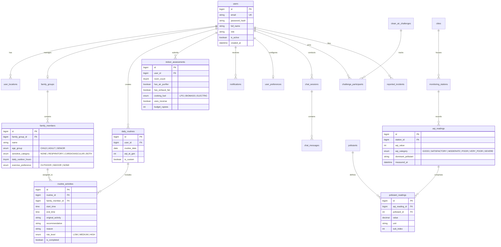

# SaansSaathi - Database Entity Relationship (ER) Diagram

## Overview

The SaansSaathi data model is structured around family units, real-time pollution telemetry, behavioral interventions, and personalized indoor mitigation.

## Table Specifications & Key Relationships

1. **`users` & `family_groups` & `family_members`**:
   - Each user can organize their household into a `family_group`.
   - `family_members` stores vulnerability profiles (`CHILD`, `SENIOR`, `RESPIRATORY`, `CARDIOVASCULAR`).
   - The Rule-Based Recommendation Engine queries these profiles against live AQI to formulate customized precautions.

2. **`monitoring_stations`, `aqi_readings` & `pollutant_readings`**:
   - Normalized telemetry schema. `aqi_readings` preserves historical values calculated using CPCB sub-index algorithms.
   - Individual pollutant measurements (PM2.5, PM10, NO2, SO2, CO, O3) are kept in `pollutant_readings`.

3. **`indoor_assessments`**:
   - Records home factors (room count, presence of exhaust, incense burning, cooking fuel, budget).
   - Feeds the AI Indoor Air Hack Generator to formulate budget-appropriate Clean Air Room guidance.

4. **`daily_routines` & `routine_activities`**:
   - Contains hour-by-hour schedules with recommended adjustments based on diurnal inversion curves.
